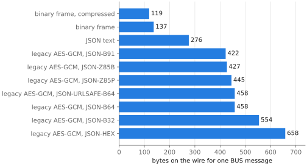

# HiveMind Bus Client documentation
<!-- agent-hint
covers: the reading order of the docs and one line for each page
source: docs/
generated: no
verify: diff <(ls docs/*.md | grep -v index.md | xargs -n1 basename | sort) <(grep -o '([a-z0-9-]*\.md)' docs/index.md | tr -d '()' | sort -u)
see: ../README.md
-->

`hivemind-bus-client` connects a Python program to a HiveMind hub over an encrypted session and carries OVOS bus messages in both directions.

<picture>
  <source media="(prefers-color-scheme: dark)" srcset="img/encoding-sizes-dark.svg">
  
</picture>

`img/measure_encoding_sizes.py` writes `img/encoding-sizes-results.json`, and `img/plot_encoding_sizes.py` makes this figure from it. [Messages](messages.md#serialization) explains each encoding.

## Quickstart

```bash
uv pip install --prerelease=allow "hivemind-bus-client[async]"
hivemind-client --app docs-sat set-identity --key docs-key-0123 \
    --password "correct-horse-battery-staple-docs" --host 127.0.0.1 --port 5678
hivemind-client --app docs-sat test-identity
```

```text
== Identity successfully connected to HiveMind!
```

## Pages

| Page | What you get there |
| :--- | :--- |
| [Install and connect](install-and-connect.md) | A local hub, then a sync and an async round trip, with the connect flow |
| [Identity](identity.md) | `NodeIdentity(app_name=...)`, the shared file, `--app` and `--shared`, and the refusal |
| [CLI reference](cli.md) | Every `hivemind-client` command, its options and real output |
| [Messages](messages.md) | `HiveMessage` types, payload rules, binary payloads and the serialization encodings |
| [Routing and peers](routing-and-peers.md) | INTERCOM to one peer, the trusted keys, QUERY, CASCADE and the PING map |
| [Wire format](wire-format.md) | The bit layout of a binary frame and the rules for an encoder in another language |
| [Security](security.md) | The Noise XXpsk2 and KKpsk0 handshakes, server key pinning, `forget-server` and the PSK cache |
| [HTTP client](polling-client.md) | `HiveMindHTTPClient` for a hub that runs the HTTP network protocol |
| [Troubleshooting](troubleshooting.md) | Each error you can see, what causes it and what to do |
| [Contributing](contributing.md) | Development setup, the test suites and the repository rules |
