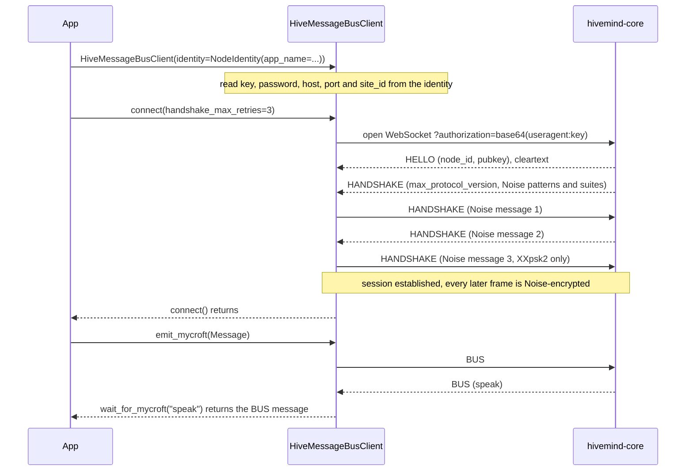

# Install and connect
<!-- agent-hint
covers: how to install the client, start a local hub, and do a sync and an async round trip
source: hivemind_bus_client/client.py:HiveMessageBusClient, hivemind_bus_client/async_client.py:AsyncHiveMessageBusClient, pyproject.toml
generated: no
verify: python -c "from hivemind_bus_client import HiveMessageBusClient, AsyncHiveMessageBusClient as A; import inspect; s=inspect.signature(HiveMessageBusClient.connect); assert s.parameters['handshake_max_retries'].default is None; assert 'wait_for_mycroft' in dir(A)"
see: identity.md
-->

This page installs the client, starts a hub on your machine, and sends one utterance through it with the sync client and with the async client.

## Example

```python
from ovos_bus_client.message import Message
from ovos_utils.log import LOG
from hivemind_bus_client import HiveMessageBusClient
from hivemind_bus_client.identity import NodeIdentity

LOG.set_level("ERROR")

client = HiveMessageBusClient(identity=NodeIdentity(app_name="docs-sat"))
client.connect(handshake_max_retries=3)

client.emit_mycroft(Message("recognizer_loop:utterance",
                            {"utterances": ["hello hive"]},
                            {"destination": "skills"}))
reply = client.wait_for_mycroft("speak", timeout=5)
print(reply.msg_type, reply.payload.msg_type, reply.payload.data)
client.close()
```

```text
bus speak {'utterance': 'you said hello hive'}
```

The async client has the same calls as coroutines:

```python
import asyncio

from ovos_bus_client.message import Message
from ovos_utils.log import LOG
from hivemind_bus_client import AsyncHiveMessageBusClient
from hivemind_bus_client.identity import NodeIdentity

LOG.set_level("ERROR")


async def main():
    client = AsyncHiveMessageBusClient(identity=NodeIdentity(app_name="docs-sat"))
    await client.connect(handshake_max_retries=3)
    await client.emit_mycroft(Message("recognizer_loop:utterance",
                                      {"utterances": ["hello async hive"]},
                                      {"destination": "skills"}))
    reply = await client.wait_for_mycroft("speak", timeout=5)
    print(reply.msg_type, reply.payload.msg_type, reply.payload.data)
    await client.close()

asyncio.run(main())
```

```text
bus speak {'utterance': 'you said hello async hive'}
```

## Steps

These steps keep the hub state in one scratch folder, so they do not touch `~/.config`. The hub uses port 15678 and its OVOS bus uses port 18181, so they do not collide with a hub or a bus that already runs. A production hub listens on port 5678.

1. Make a virtual environment and install the client, the hub and an OVOS message bus:

   ```bash
   uv venv .venv && . .venv/bin/activate
   uv pip install --prerelease=allow "hivemind-bus-client[async]" hivemind-core ovos-messagebus
   ```

2. Point the XDG folders at a scratch folder, and set the OVOS bus port:

   ```bash
   export J=$PWD/hm-demo
   export XDG_CONFIG_HOME=$J/config XDG_DATA_HOME=$J/data XDG_CACHE_HOME=$J/cache
   mkdir -p $J/config/mycroft
   echo '{"websocket": {"host": "127.0.0.1", "port": 18181}}' > $J/config/mycroft/mycroft.conf
   ```

3. Run `hivemind-core print-config` once. It writes `$J/config/hivemind-core/server.json`. In that file, set `agent_protocol` → `hivemind-ovos-agent-plugin` → `port` to `18181`, set `network_protocol` → `hivemind-websocket-plugin` → `host` to `127.0.0.1` and `port` to `15678`, and set `presence` → `enabled` to `false`.

4. Give the hub a node identity. hivemind-core 5.3.15a2 and earlier releases read the hub key from the shared identity file, and the client library does not create that file by itself (see [Identity](identity.md#the-shared-file)). These releases need this step. Releases that include [HiveMind-core#418](https://github.com/JarbasHiveMind/HiveMind-core/pull/418) make their own key in `$XDG_CONFIG_HOME/hivemind/hivemind-core/` on the first start, and do not need this step:

   ```bash
   hivemind-client --shared set-identity --siteid hub
   ```

   ```text
   PUBKEY: -----BEGIN PUBLIC KEY-----
   ...
   -----END PUBLIC KEY-----
   identity saved: /home/user/hm-demo/config/hivemind/_identity.json
   ```

5. Start the OVOS bus and the hub, each in its own terminal with the same environment:

   ```bash
   ovos-messagebus
   hivemind-core listen
   ```

   The hub log ends with `hivemind-core service ready!` and `ws listener started`.

6. Register the client on the hub:

   ```bash
   hivemind-core add-client --name docs-sat --access-key docs-key-0123 \
       --password "correct-horse-battery-staple-docs" \
       --allow speak --allow recognizer_loop:utterance
   ```

   ```text
   Credentials added to database!

   Node ID: 1
   Admin Privileges: False
   Friendly Name: docs-sat
   Access Key: docs-key-0123
   Password: correct-horse-battery-staple-docs
   Allowed Message Types: speak, recognizer_loop:utterance
   ```

7. Store the credentials for the application `docs-sat`, then test them:

   ```bash
   hivemind-client --app docs-sat set-identity --key docs-key-0123 \
       --password "correct-horse-battery-staple-docs" \
       --host 127.0.0.1 --port 15678 --siteid kitchen
   hivemind-client --app docs-sat test-identity
   ```

   ```text
   identity saved: /home/user/hm-demo/config/hivemind/docs-sat/_identity.json
   == Identity successfully connected to HiveMind!
   ```

8. The demo hub has no skills, so nothing answers an utterance. Run this responder on the OVOS bus. It answers each utterance with a `speak` message, then marks the utterance as handled, which ends a [QUERY](routing-and-peers.md#query) answer:

   ```python
   from ovos_bus_client import MessageBusClient
   from ovos_utils import wait_for_exit_signal

   bus = MessageBusClient(port=18181)
   bus.run_in_thread()


   def answer(message):
       bus.emit(message.reply("speak", {"utterance": "you said " + message.data["utterances"][0]}))
       bus.emit(message.reply("ovos.utterance.handled"))


   bus.on("recognizer_loop:utterance", answer)
   wait_for_exit_signal()
   ```

9. Run the sync or the async example at the top of this page.

## The connect flow

`connect()` binds the protocol to the local bus, opens the WebSocket in a worker thread, and blocks until the handshake completes. [Security](security.md) explains the handshake messages.



## Reference

Constructor arguments of `HiveMessageBusClient` (`hivemind_bus_client/client.py`). A `None` credential comes from the identity.

| Argument | Default | Effect |
| :--- | :--- | :--- |
| `key` | `None` | Access key. Falls back to `identity.access_key`. |
| `password` | `None` | Password, the Noise PSK input. Falls back to `identity.password`. |
| `host` | `None` | `ws://host` or `wss://host`. Falls back to `identity.default_master`. |
| `port` | `None` | Falls back to `identity.default_port`. |
| `identity` | `None` | A `NodeIdentity`. Without it the client uses the shared file and logs a warning. |
| `useragent` | `""` | Name sent in the `authorization` query. Empty means `HiveMessageBusClientV0.0.1`. |
| `site_id` (on `connect`) | `None` | Site of this connection. Falls back to `identity.site_id`, then `"unknown"`. |
| `compress` | `True` | Compress binary frames. |
| `binarize` | `True` | Send binary frames when the hub also supports them. |
| `share_bus` | `False` | Forward the local OVOS bus to the hub as `SHARED_BUS`. |
| `internal_bus` | `None` | An OVOS bus client to use. Without it the client makes a `FakeBus`. |
| `max_protocol_version` | `3` | Highest protocol version to offer. Set `2` to force the legacy handshake. |
| `websocket_connect_timeout` | `WEBSOCKET_CONNECT_TIMEOUT` | Seconds before a stalled connection attempt is dropped. `None` or `0` disables it. |
| `websocket_ping_interval`, `websocket_ping_timeout` | `None` | WebSocket keepalive. |

`connect(bus=FakeBus(), protocol=None, site_id=None, handshake_max_retries=None)` retries the handshake forever when `handshake_max_retries` is `None`. Each retry waits 5 seconds. A refused access key raises `ConnectionRefusedError` at once, and the client does not reconnect.

`AsyncHiveMessageBusClient` takes the same arguments except `websocket_connect_timeout`. It needs the `async` extra.

`await client.emit()` of the async client differs from the sync `emit()` in two ways:

- It does not start the QUERY timeout (`query_timeout`). After you send a `QUERY`, wait for the answer with `wait_for_response(..., timeout=...)`, because nothing else limits the wait.
- It ignores `HiveMessage.bin_type`. The sync client uses the `bin_type` of the message when `binary_type` is `UNDEFINED`. With the async client, give `binary_type=` each time you send a `BINARY` message.

---
[Home](index.md) · [Identity →](identity.md)
