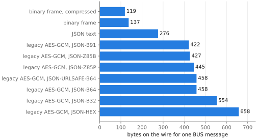

# Messages
<!-- agent-hint
covers: the HiveMessage envelope, the message types, the payload rules, binary payloads, and the serialization encodings
source: hivemind_bus_client/message.py, hivemind_bus_client/serialization.py, hivemind_bus_client/encryption.py:SupportedEncodings, hivemind_bus_client/client.py:emit
generated: no
verify: diff <(python <(awk '/^```python/{f=1;next} f&&/^```/{exit} f' docs/messages.md) 2>/dev/null) <(awk '/^```text/{f=1;next} f&&/^```/{exit} f' docs/messages.md)
see: routing-and-peers.md, wire-format.md
-->

A `HiveMessage` is the envelope that travels between nodes. This page shows how to build one, which payload each type takes, and how the client puts it on the wire.

## Example

```python
from ovos_bus_client.message import Message
from hivemind_bus_client.message import HiveMessage, HiveMessageType
from hivemind_bus_client.serialization import get_bitstring, decode_bitstring

bus = HiveMessage(HiveMessageType.BUS, Message("speak", {"utterance": "hello"}))
print(bus.serialize())

wrapped = HiveMessage(HiveMessageType.PROPAGATE, bus, target_site_id="kitchen")
print(wrapped.payload.msg_type, wrapped.payload.payload.msg_type)

try:
    HiveMessage(HiveMessageType.PROPAGATE, Message("speak", {"utterance": "hello"}))
except ValueError as error:
    print("ValueError:", error)

back = HiveMessage.from_wire(bus.serialize())
print(back.msg_type, back.payload.data)

frame = get_bitstring(HiveMessageType.BUS, bus.payload, compressed=True)
print(decode_bitstring(frame).payload.data)
```

```text
{"msg_type": "bus", "payload": {"type": "speak", "data": {"utterance": "hello"}, "context": {}}, "metadata": {}, "route": [], "node": null, "target_site_id": null, "target_pubkey": null, "source_peer": null}
HiveMessageType.BUS speak
ValueError: a HiveMessageType.PROPAGATE payload must be a nested HiveMessage with a 'msg_type' (HIVEMIND-MSG-1 §4 with §2), got a Layer-1 Message. Wrap it: HiveMessage(HiveMessageType.PROPAGATE, HiveMessage(HiveMessageType.BUS, payload=<Message>)).
bus {'utterance': 'hello'}
{'utterance': 'hello'}
```

## Steps

1. Send an OVOS message to the hub with `client.emit_mycroft(Message(...))`. The client wraps it in a `BUS` envelope and adds the session and the site to its context.
2. To route a message through the hive, wrap a `BUS` envelope in a routing type: `HiveMessage(HiveMessageType.ESCALATE, HiveMessage(HiveMessageType.BUS, message))`. Send it with `client.emit(...)`.
3. Set `target_site_id` on the outer envelope of a `BROADCAST`, `PROPAGATE` or `ESCALATE`. A node delivers the inner `BUS` message to its bus only when its site matches `target_site_id`. When it is not set, no node delivers it.
4. Listen with `client.on(HiveMessageType.X, handler)` for envelopes, or `client.on_mycroft("speak", handler)` for OVOS messages inside `BUS`.
5. Wait for one answer with `wait_for_message`, `wait_for_payload`, `wait_for_mycroft`, `wait_for_response` or `wait_for_payload_response`. Each takes a `timeout` in seconds (default 3) and returns `None` when it runs out.

## Message types

`HiveMessageType` in `hivemind_bus_client/message.py`. The binary code is the 5-bit type code of a binary frame (`_INT2TYPE` in `serialization.py`).

| Type | Value | Binary code | Payload |
| :--- | :--- | :--- | :--- |
| `HANDSHAKE` | `shake` | 0 | Handshake fields, may be empty |
| `BUS` | `bus` | 1 | One OVOS message: `type`, `data`, `context` |
| `SHARED_BUS` | `shared_bus` | 2 | One OVOS message, shared for passive monitoring |
| `BROADCAST` | `broadcast` | 3 | A nested `HiveMessage` |
| `PROPAGATE` | `propagate` | 4 | A nested `HiveMessage` |
| `ESCALATE` | `escalate` | 5 | A nested `HiveMessage` |
| `HELLO` | `hello` | 6 | Node announcement fields, may be empty |
| `QUERY` | `query` | 7 | A nested `HiveMessage` |
| `CASCADE` | `cascade` | 8 | A nested `HiveMessage` |
| `PING` | `ping` | 9 | A JSON object, may be absent |
| `RENDEZVOUS` | `rendezvous` | 10 | A JSON object |
| `BINARY` | `bin` | 12 | `bytes` |
| `INTERCOM` | `intercom` | none | An encrypted, signed JSON object, never empty |

Code 11 is reserved. `INTERCOM` has no binary code, so it always travels as text.

## Payload rules

The constructor and `HiveMessage.from_wire()` enforce these rules:

- An unknown `msg_type` raises `ValueError("Unknown HiveMessage.msg_type")`.
- A routing type (`BROADCAST`, `PROPAGATE`, `ESCALATE`, `QUERY`, `CASCADE`) takes a nested `HiveMessage`. A bare OVOS `Message` raises the `ValueError` in the example.
- A `BINARY` payload must be `bytes`. Another type raises `MalformedWirePayload`.
- A `str` payload raises `MalformedWirePayload`. Parse a wire frame with `HiveMessage.from_wire()`.
- `bin_type` is valid only on `BINARY`.
- On the wire, every type except `PING` must carry a `payload`. `BUS`, `SHARED_BUS` and the routing types refuse an empty `{}` payload, and `INTERCOM` refuses an empty payload too.

`MalformedWirePayload` is a `ValueError`. The client drops a malformed frame and keeps the connection.

## Binary payloads

`HiveMindBinaryPayloadType` tells the receiver what the bytes of a `BINARY` message are:

| Name | Value | Content |
| :--- | :--- | :--- |
| `UNDEFINED` | 0 | No information |
| `RAW_AUDIO` | 1 | PCM, signed 16-bit little-endian, 16 kHz, mono unless metadata says other |
| `NUMPY_IMAGE` | 2 | An image as a numpy array |
| `FILE` | 3 | A file to save |
| `STT_AUDIO_TRANSCRIBE` | 4 | One utterance of audio, to transcribe and return |
| `STT_AUDIO_HANDLE` | 5 | One utterance of audio, to transcribe and handle |
| `TTS_AUDIO` | 6 | Synthesized speech to play |

To receive TTS audio or files, subclass `BinaryDataCallbacks` and pass it as `bin_callbacks=`. Override `handle_receive_tts(bin_data, utterance, lang, file_name)` and `handle_receive_file(bin_data, file_name)`. The default methods log a warning and drop the data.

## Serialization

The client picks the form of each frame in `emit()`:

- A `BINARY` message is always a binary frame.
- `HELLO` and `HANDSHAKE` are always JSON text.
- Another type with a binary code is a binary frame when the hub announced binary support and `binarize=True`. Else it is JSON text.
- `compress=True` compresses the binary frame. [Wire format](wire-format.md) gives the bit layout. `get_bitstring(compressed=None)` picks the smaller of the two forms.
- A frame whose metadata does not fit in 255 bytes goes as JSON text, except `BINARY`, which raises `MetadataTooLarge`.

In a protocol-v3 session, the Noise transport encrypts each frame, text or binary, and sends it as a WebSocket binary message. A frame of more than 65000 bytes goes in chunks. The legacy handshake (protocol 2 and lower) encrypts a binary frame with `encrypt_bin`, and a text frame with `encrypt_as_json`. `encrypt_as_json` writes the ciphertext, the tag and the nonce as text in one of the encodings of `SupportedEncodings`. The hub selects the encoding during the handshake.

<picture>
  <source media="(prefers-color-scheme: dark)" srcset="img/encoding-sizes-dark.svg">
  
</picture>

`img/measure_encoding_sizes.py` writes `img/encoding-sizes-results.json` for one fixed `speak` message, and `img/plot_encoding_sizes.py` makes this figure from it. The legacy rows use AES-GCM with a fixed key and nonce, so each run gives the same sizes. Run both scripts from the repository root to measure again.

---
[← CLI reference](cli.md) · [Home](index.md) · [Routing and peers →](routing-and-peers.md)
