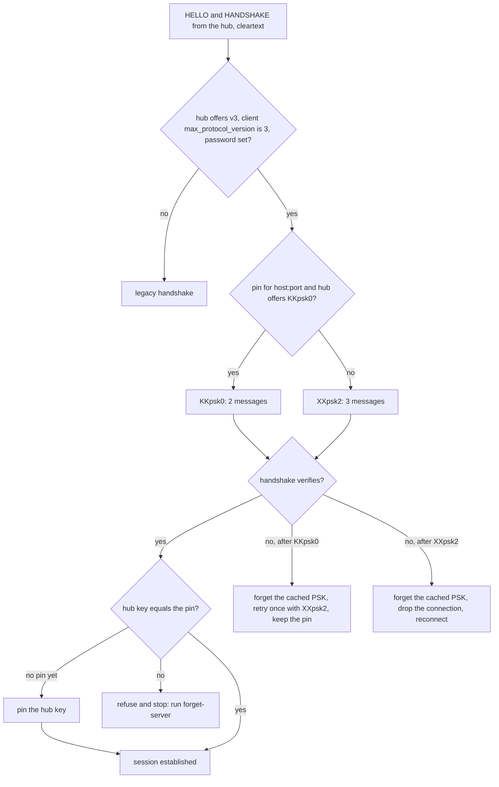

# Security
<!-- agent-hint
covers: the Noise XXpsk2 and KKpsk0 handshakes, server key pinning, forget-server, and the Noise PSK cache
source: hivemind_bus_client/noise.py, hivemind_bus_client/protocol.py:HiveMindSlaveProtocol, hivemind_bus_client/identity.py:pin_noise_key, hivemind_bus_client/scripts.py:forget_server
generated: no
verify: python -c "import hivemind_bus_client.noise as n; assert (n.NOISE_PATTERN_XX, n.NOISE_PATTERN_KK, n.NOISE_PSK_CACHE_SUFFIX, n.CHUNK_SIZE, n._MAX_CACHE_ENTRIES) == ('XXpsk2', 'KKpsk0', '_psks.json', 65000, 32); assert n.NOISE_SUITES[0] == '25519_ChaChaPoly_SHA256'"
see: polling-client.md
-->

The Noise Protocol Framework secures a protocol-v3 session. The password is the pre-shared key, and each side has a static X25519 key. This page explains the two handshakes, how the client pins the hub's key, and how it caches the derived key.

## Example

The first connection to a hub runs `XXpsk2` and pins the hub's static key. The next connection has a pinned key and runs `KKpsk0`. The client log at `INFO` level shows the pattern:

```text
INFO - starting protocol v3 handshake: Noise_KKpsk0_25519_ChaChaPoly_SHA256
INFO - protocol v3 Noise session established (pattern=KKpsk0)
```

When the hub presents a key that is not the pinned key, the client refuses the session and stops:

```text
ConnectionRefusedError: HiveMind refused this identity: the server Noise static key for 127.0.0.1:15678 does not match the pinned key. Run 'hivemind-client forget-server' if the master was reinstalled or replaced
```

## Steps

1. Give the client and the hub the same password. The hub stores it with `hivemind-core add-client --password`, and the client with `hivemind-client set-identity --password`. The password never goes on the wire.
2. Connect once. The client trusts the hub key it sees and saves it in `pinned_noise_keys`.
3. When you reinstall the hub or restore it from a backup, it has a new key. Run `hivemind-client --app <name> forget-server` on each client, then connect again.
4. When you change the password, use `set-identity --password`. It clears the PSK cache.

## The handshake

The hub sends `HELLO` and `HANDSHAKE` in cleartext. `HANDSHAKE` lists the hub's highest protocol version and its Noise patterns and suites. The client runs Noise when the hub offers protocol 3 or higher, the client's `max_protocol_version` is 3, the client has a password, and both sides share a pattern and a suite. Else it falls back to the legacy handshake.



| Item | Value | Source |
| :--- | :--- | :--- |
| Patterns | `XXpsk2` (always), `KKpsk0` (when the hub key is pinned) | `noise.py` |
| Suites, in order of preference | `25519_ChaChaPoly_SHA256`, then `25519_AESGCM_SHA256` | `NOISE_SUITES` |
| PSK | argon2id of the password, salted with SHA-256 of the hub's `node_id` | `start_noise_handshake` |
| Prologue | the hub's `HELLO` and `HANDSHAKE` payloads and the protocol name | `build_prologue` |
| Static key | `NodeIdentity.noise_key`, made on first use | `identity.py` |

The prologue binds the cleartext negotiation into the handshake. A change to `HELLO` or `HANDSHAKE` on the way makes the handshake fail. A wrong password makes it fail too.

After the handshake, the Noise transport encrypts every frame with sequential nonces, `HELLO` included. Set `max_protocol_version=2` on the client to force the legacy handshake.

A `wss://` host adds TLS around the WebSocket. Noise gives the session its encryption and authentication with `ws://` and with `wss://`.

## Server key pinning

The sync client pins the hub key under `host:port`, for example `127.0.0.1:15678`. The async client has no `host:port` value, so it pins under the hub's `node_id` from `HELLO`. A hivemind-core `node_id` is its RSA public key.

```text
"pinned_noise_keys": {
    "-----BEGIN PUBLIC KEY-----\nMIIBIjANBgkqhkiG9w0BAQE...": "...",
    "127.0.0.1:15678": "553e1edb05949a98197c2d21bab0bda3..."
}
```

A pin does not change by itself. When `KKpsk0` fails, for example because the hub no longer has this node's key, the client retries once with `XXpsk2`. That retry must show the pinned hub key too. A different key stops the client, and the client does not reconnect.

### Forget a server key

`forget-server` removes the pin for one `host:port`. The defaults come from the identity:

```bash
hivemind-client --app docs-sat forget-server
```

```text
forgot pinned key for 127.0.0.1:15678
the next connection will trust and pin the key it sees
```

Use it only when you know that the hub changed its key. A changed key with no reinstall can mean that another machine answers at that address.

`forget-server` does not remove a pin that the async client made under the hub's `node_id`. To remove that pin, call `NodeIdentity(app_name="<name>").forget_noise_key(node_id)` in Python. Issue [#325](https://github.com/JarbasHiveMind/hivemind-websocket-client/issues/325) tracks one pin id for both clients.

An application that reads the shared file as a fallback keeps its pins in the shared file. `forget-server` says so:

```text
<app> has no identity file of its own: this pin is in the shared <path>, checked by every application on this box
```

## The PSK cache

argon2id runs with `time_cost=3` and `memory_cost=64 MiB`. On a small board it takes seconds. The result changes only when the password or the hub's `node_id` changes, so the client stores it next to the static key:

```text
unnamed-node_noise.key
unnamed-node_noise_psks.json
```

- The file name is the static key file name with `_psks.json` in place of the extension.
- Each entry name is the hub `node_id`, with a 16-hex-digit SHA-256 tag of the access key in front. The file never holds the access key or the password.
- The file holds at most 32 entries. A new entry pushes out the oldest.
- The client ignores a cache file with any group or other permission bit set, a file larger than 1 MiB, and a damaged file. It then derives the key again.
- When the hub rejects a cached key, the client removes that entry. The next attempt derives from the current password.
- `set-identity --password` with a changed password deletes the whole file. Without this step, the first connection to each hub fails once before the client removes the stale entry.

---
[← Wire format](wire-format.md) · [Home](index.md) · [HTTP client →](polling-client.md)
